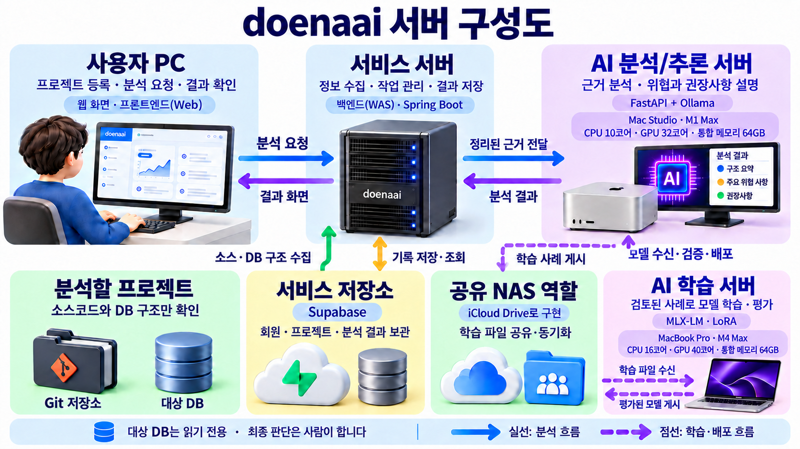

# doenaai

고객 요구사항을 프로젝트 소스와 DB 구조에 연결해 영향 범위·위험·예상 작업량·
기간을 분석하고, 여러 조직의 PM/PL이 근거 있는 견적을 작성하도록 지원하는
플랫폼 모노레포입니다.

## 모듈

- `frontend`: 웹 화면 · 프론트엔드(Web), Vue 3 + Vite + Vue Router + Pinia + Axios + Supabase
- `backend`: 서비스 서버 · 백엔드(WAS), Java 25 + Spring Boot 4.1
- `ai-server`: AI 분석/추론 서버, Python FastAPI + Ollama
- `training`: AI 학습 서버, MLX-LM / LoRA 학습·평가 영역
- `shared`: 공통 JSON Schema
- `supabase`: DB 마이그레이션
- `docs`: 프로젝트 개요, 시스템 아키텍처, 현재 진행상황, 다른 PC 작업 인수인계

현재 프론트엔드는 화면 검토를 위해 하드코딩 데이터를 기본값으로 사용합니다.
`VITE_USE_MOCK=false`로 변경하면 Spring Boot API 호출 구조로 전환됩니다.

## 구성 요소 명칭

| 화면·공유 자료의 명칭 | 개발 명칭 | 역할 |
|---|---|---|
| 웹 화면 | 프론트엔드(Web) | 사용자의 입력, 분석 요청, 상태와 결과 표시 |
| 서비스 서버 | 백엔드(WAS) | 인증·권한, 프로젝트 관리, Git·DB 근거 수집, 분석 작업과 결과 관리 |
| AI 분석/추론 서버 | `ai-server` · FastAPI + Ollama | 수집된 근거를 모델에 전달하고 영향도·위험도 분석 응답 생성 |
| AI 학습 서버 | `training` · MLX-LM / LoRA | 검토된 사례 수신, 데이터셋 구성, 모델 학습·평가 |

Mac Studio와 MacBook은 현재 기준 장비명이며 서버 역할을 대신하는 이름으로 쓰지 않습니다.
Vue 프론트엔드는 브라우저에서 실행되는 웹 화면이고, 운영 배포 시 웹 서버가 빌드 파일을 제공합니다.
Spring Boot 백엔드는 WAS에서 업무 API를 처리합니다. 개발자끼리는 프론트엔드·백엔드로,
비개발자에게는 웹 화면·서비스 서버로 설명하면 됩니다.



기준 장비는 AI 분석/추론 서버가 Mac Studio M1 Max·CPU 10코어·GPU 32코어·통합 메모리 64GB,
AI 학습 서버가 MacBook Pro M4 Max·CPU 16코어·GPU 40코어·통합 메모리 64GB입니다.
그림의 공유 NAS는 별도 NAS 장비가 아니라 **iCloud Drive 공유 폴더로 구현한 파일 전달 공간**입니다.
SSH로 직접 전송하기 어려운 환경에서 공통 저장 공간을 사용하는 방식이며, Supabase 서비스 저장소와는 별개입니다.

## 공식 문서

처음 합류한 팀원은 [팀원 온보딩 가이드](docs/07_팀원_온보딩_프로젝트_설명.md)를 먼저 읽어주세요.
프로젝트 목적, 현재 서버 구성도, 분석 순서도, 계정/DB 구분과 공동개발 실행 규칙을 정리했습니다.
최신 Worker 실행 경로는 `06`·`07`, Qwen 모델 선정·운영 설정은 `10`·`11` 문서를 기준으로 확인합니다.
MacBook의 학습 환경·QLoRA 검증·데이터 변환·평가 도구 진행상황은 `12` 문서가 최신입니다.
전체 제품의 현재 구현·검증·미완료 상태는 `03`, Frontend 화면별 API 연결·다음 작업은 `13` 문서를 기준으로 확인합니다.
다른 PC가 작업을 이어받을 때는 `09` 문서의 최신 갱신 안내와 `12` 문서를 함께 읽어주세요.

1. `docs/01_프로젝트_개요.md`
   - 프로젝트 목적, 기술 스택, 저장소와 기능 구조
2. `docs/02_시스템_아키텍처.md`
   - Frontend, Backend, AI 분석/추론 서버, AI 학습 서버, Supabase 구성과 흐름
3. `docs/03_현재_진행상황.md`
   - 완료/미완료 기능, 검증 결과, 알려진 문제, 다음 작업
4. `docs/04_다른_PC_Backend_작업_인수인계.md`
   - 다른 PC의 Backend 담당 범위, 실행 준비, 구현 순서와 완료 기준
5. `docs/05_2026-09-23_MAC_STUDIO_작업_인수인계.md`
   - 9월 23일 기준 Mac 작업 이력
6. `docs/06_2026-10-12_분석_Worker_구현_인수인계.md`
   - 최신 Worker, 소스/DB 수집, AI 호출, 결과 저장과 검증 기록
7. `docs/07_팀원_온보딩_프로젝트_설명.md`
   - 팀원 공유용 목적·구성·흐름·구현 범위·역할 분담 안내
8. `docs/08_2026-10-13_AI_분석과_맥북_학습_인수인계.md`
   - Mac Studio 추론과 M4 Max MacBook 학습의 역할, DB 분석 분기, 검증·미완료 사항
9. `docs/09_2026-10-13_MacBook_Codex_인수인계.md`
   - 새 PC의 Codex를 위한 읽기 순서, 현재 검증 상태, 다음 시험과 실행 명령
10. `docs/10_2026-10-14_AI_모델_선정_근거.md`
    - Qwen3.8 27B 선정 이유, 모델 비교와 남은 품질 검증
11. `docs/11_2026-10-14_MAC_STUDIO_QWEN_학습_평가_전달.md`
    - Mac Studio 운영 설정과 미승인 학습 전 기준 응답
12. `docs/12_2026-10-14_MacBook_학습_도구_진행상황.md`
    - MacBook 학습 도구 완료 범위, 승인 데이터 전달과 장비별 다음 작업
13. `docs/13_2026-10-14_Frontend_구현_점검.md`
    - 화면별 실제 구현·없는 API·미동작 버튼·계약 불일치·검증 및 후속 구현 순서

## 프론트 실행

```bash
cd frontend
npm install
npm run dev
```

## 백엔드 실행

JDK 25가 필요합니다.

```bash
cd backend
./gradlew bootRun
```

Windows PowerShell에서는 `./gradlew` 대신 `.\gradlew.bat`을 사용합니다.

## AI 분석/추론 서버 실행

```bash
cd ai-server
python -m venv .venv
source .venv/bin/activate
pip install -r requirements.txt
uvicorn app.main:app --reload --port 8000
```
