# 2. doenaai 시스템 아키텍처

> 2026-10-14 안내: 이 문서는 초기 설계·목표 구성을 포함한다. 실제 Worker는 Backend 프로세스 안에서 실행하며 현재 모델은 Qwen3.8 27B다. 최신 구현·미완료 상태는 [현재 진행상황](03_현재_진행상황.md), 실제 분석 경로는 [06번](06_2026-10-12_분석_Worker_구현_인수인계.md)·[07번](07_팀원_온보딩_프로젝트_설명.md)을 기준으로 확인한다.

최종 갱신: 2026-07-30

> 이 문서 본문은 초기 설계 기록이다. 2026-10-12 현재 Git/DB 수집 Worker는
> FastAPI가 아니라 **Spring Boot Backend 안에서 실행**되며, 조직·요구사항 API와
> 실제 분석 결과 저장/조회도 추가되었다. 현재 서버 구성과 구현/미구현 구분은
> [팀원 온보딩 가이드](07_팀원_온보딩_프로젝트_설명.md)와
> [Worker 인수인계](06_2026-10-12_분석_Worker_구현_인수인계.md)를 먼저 확인한다.

이 문서는 웹 화면(프론트엔드·Web), 서비스 서버(백엔드·WAS), AI 분석/추론 서버, 로컬 모델 runtime, AI 학습 서버,
Supabase의 배치와 책임 및 주요 요청 흐름을 설명한다.

- 프로젝트 목적과 기술/저장소 구조: `docs/01_프로젝트_개요.md`
- 구현 현황과 다음 작업: `docs/03_현재_진행상황.md`

## 1. 전체 구성도

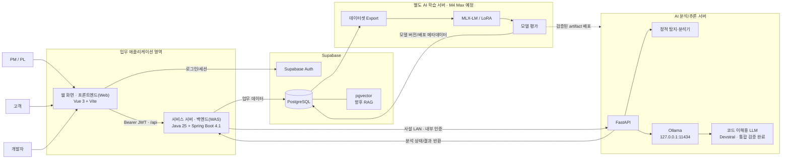

## 2. 물리 배치

| 영역 | 실행 위치 | 공개 범위 | 역할 |
|---|---|---|---|
| Browser | 사용자 PC | 사용자 | UI |
| 웹 화면 · 프론트엔드(Web) | 개발 PC 또는 웹 서버 | 서비스망 또는 고객망 | 정적 웹 파일 제공과 브라우저 화면 실행 |
| 서비스 서버 · 백엔드(WAS) | 서비스 서버, 고객 서버 또는 개발 PC | 인증된 API | 인증, 권한, 데이터, 작업 제어 |
| Supabase | Supabase Cloud | TLS | Auth, PostgreSQL |
| AI 분석/추론 서버 · FastAPI | 기준 장비 Mac Studio | 사설 LAN | 모델 호출과 분석 응답 검증 |
| Ollama | Mac Studio | localhost만 | 로컬 모델 runtime |
| AI 학습 서버 | 기준 장비 M4 Max MacBook | 관리망 | 데이터셋, LoRA, 평가 |

현재 개발 단계에서는 Frontend와 Spring Boot를 같은 Windows PC에서 실행하고,
FastAPI/Ollama를 Mac Studio에서 실행하는 구성을 사용한다.

### 목표 배포 형태

제품은 특정 회사 내부망 전용으로 한정하지 않는다.

- 서비스형: 하나의 플랫폼에서 여러 회사·조직을 tenant로 분리
- 구축형: 고객 환경에 Frontend, Backend, DB와 AI runtime을 별도로 배치
- 혼합형: 서비스 서버는 중앙 서비스에 두고 고객 정책에 따라 AI 분석부만 별도 배치

Mac Studio와 Ollama는 현재 개발 및 기준 배치다. 모든 고객이 동일 장비를
보유해야 하는 제품 구조는 아니며, 운영 단계에서는 중앙 AI 서비스 또는
고객 소유 inference 서버로 교체할 수 있어야 한다.

현재 Supabase와 업무 스키마는 조직 tenant 경계를 구현하지 않았다. 따라서 현재
구성만으로 여러 회사의 운영 데이터를 함께 수용할 수 없으며, 외부 서비스 전환
전에 조직·구성원·프로젝트 범위와 tenant 권한 검증을 추가해야 한다.

## 3. 논리 계층

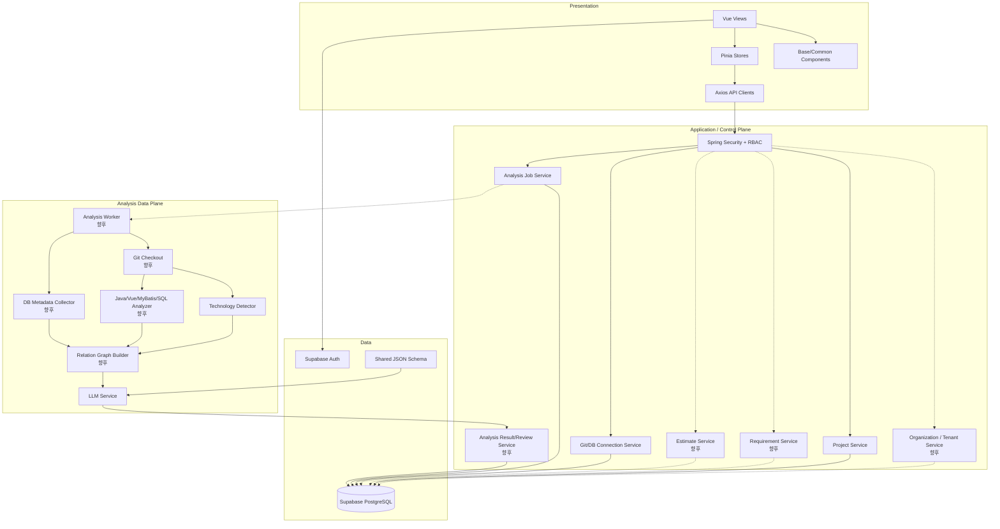

점선으로 표시된 조직, 요구사항, 견적, 결과 검토 및 Worker 흐름은 목표
아키텍처이며 아직 완전히 구현되지 않았다.

## 4. 서버별 책임

### Frontend

담당:

- 로그인 UI와 Supabase session
- 역할별 업무 화면
- PM/PL 요구사항·분석·견적 편집 화면
- 고객 제한 조회 화면
- 개발자 영향 근거·위험 검토 화면
- 사용자 입력 검증
- permission 기반 메뉴/버튼 표시
- 프로젝트 등록
- Git/DB 연결 테스트 요청
- 분석 작업 생성 요청
- 진행률 polling과 결과 표시

담당하지 않음:

- 최종 권한 판정
- DB 직접 업무 접근
- Git/DB credential 저장
- JWT 서명 직접 검증
- AI 모델 직접 호출

### Spring Boot Backend

담당:

- Supabase JWT 서명과 issuer 검증
- 사용자 역할과 permission 확인
- 향후 조직 tenant와 고객별 접근 범위 검증
- 프로젝트와 구성원 접근 제어
- 향후 요구사항, 작업 항목, 견적 버전과 공개 상태 관리
- Git host 정책
- Git/DB 연결 테스트
- credential AES-256-GCM 암호화
- 분석 작업 생성과 상태 제어
- 향후 FastAPI Worker 인증
- 분석 결과 저장과 검토/승인

Spring Boot는 시스템의 control plane이며 보안 경계의 중심이다.

### FastAPI AI 분석/추론 서버

담당:

- 내부 API key 검증
- 분석 입력의 민감정보 차단
- 저장소 기술 스택 탐지
- 향후 소스/DB 상세 분석
- Ollama 호출
- JSON Schema/Pydantic 결과 검증
- 모델 timeout과 장애를 업무 오류로 변환
- 향후 분석 Worker 실행

FastAPI는 브라우저에 직접 공개하지 않는다.

### Ollama

담당:

- 모델 load/unload
- token inference
- 구조화 출력

담당하지 않음:

- 사용자 인증
- 프로젝트/DB 접근
- 분석 작업 상태
- Git credential

Ollama는 인증 없는 로컬 runtime이므로 `127.0.0.1`에만 binding한다.

### AI 학습 서버

목표 책임:

- 승인된 분석 결과 export
- 개인정보와 비밀값 제거
- JSONL 데이터셋 구성
- Train/validation/test 분리
- MLX-LM LoRA 학습
- 자동/수동 평가
- artifact checksum
- 모델 버전 등록
- 검증된 adapter 또는 merged model 배포

AI 학습 서버는 운영 분석 요청을 직접 처리하지 않는다.

### Supabase

담당:

- 사용자 인증
- PostgreSQL 데이터
- 프로젝트와 분석 작업/결과
- 모델/학습/배포 메타데이터
- 향후 RAG vector

브라우저는 Supabase Auth를 사용하지만 업무 테이블은 Spring Boot를 통해 접근한다.

## 5. 인증과 권한 흐름

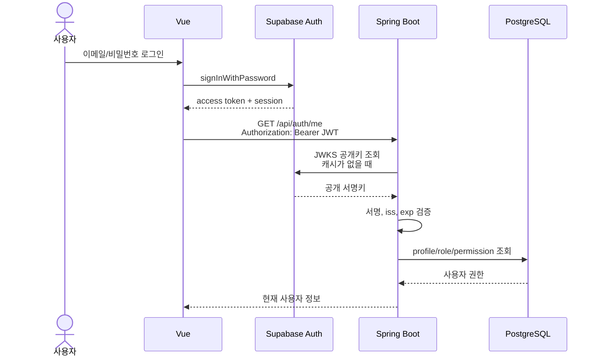

Spring Boot 설정:

```text
issuer-uri:
  https://{project-id}.supabase.co/auth/v1

jwk-set-uri:
  https://{project-id}.supabase.co/auth/v1/.well-known/jwks.json
```

JWKS timeout은 JWT 자체 오류가 아니라 Backend에서 Supabase 공개키 endpoint를
읽지 못한 네트워크 오류다.

## 6. 프로젝트 연결과 견적 흐름

### 프로젝트 등록과 연결

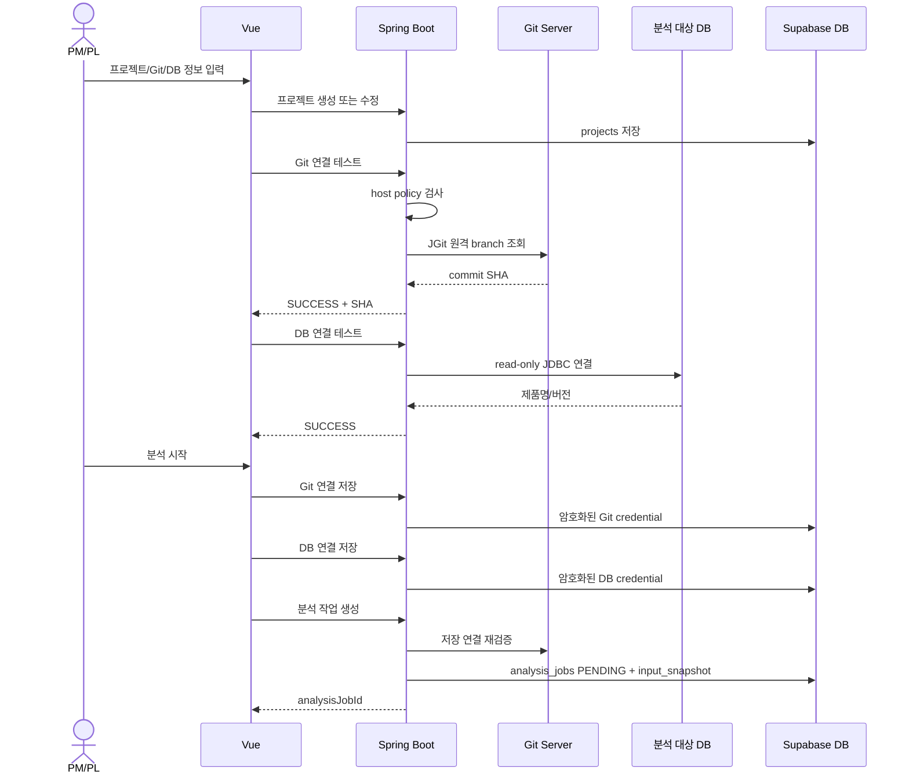

연결 테스트만 실행하면 credential은 저장하지 않는다. 분석 시작 과정에서 연결을
다시 검증한 후 암호화 저장한다.

### 고객 요구사항 접수부터 견적까지

다음은 목표 업무 흐름이다. 요구사항·견적 저장 구조는
`007_organization_requirement_estimate.sql`에 작성했지만 아직 Supabase 적용과
Backend API 연결 전이며, 자동 Worker도 구현되지 않았다.

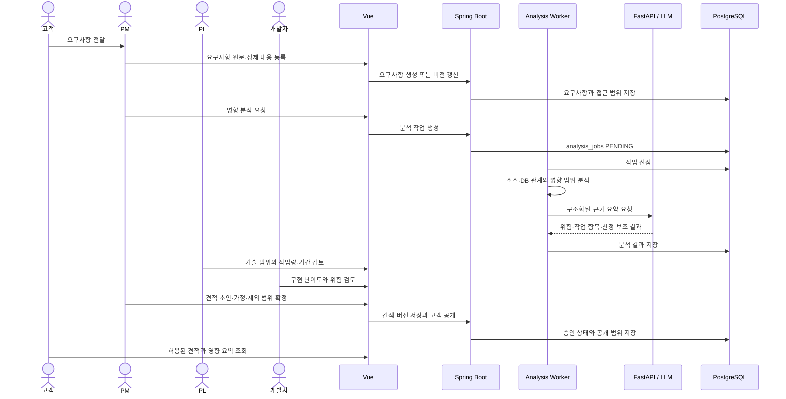

AI 출력은 견적의 참고값이다. 최종 작업량, 일정과 비용은 분석 근거 및
PL·개발자 의견을 바탕으로 PM/PL이 확정한다.

## 7. Git 보안 구조

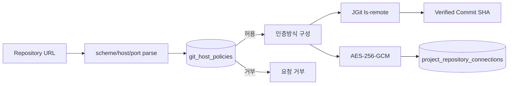

지원 인증:

```text
NONE
HTTPS_TOKEN
HTTPS_BASIC
SSH_KEY
PROVIDER_APP  향후 확장용
```

보안 규칙:

- URL에 username/token 포함 금지
- allowlist host만 허용
- 허용 protocol/port만 사용
- 비밀값 평문 저장 금지
- 조회 응답에 비밀값과 암호문 제외
- SSH는 known_hosts를 통한 서버 키 검증

## 8. DB 연결 구조

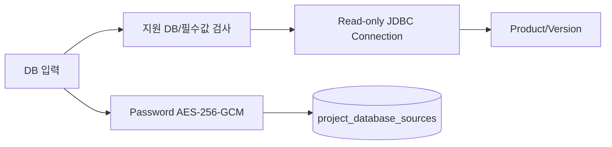

현재 실제 연결:

- Oracle
- PostgreSQL

분석 계정 권장 권한:

- schema metadata 조회
- 필요한 catalog/view 조회
- 업무 데이터 수정 권한 없음
- DDL/DML 실행 권한 없음

## 9. 분석 작업 목표 흐름

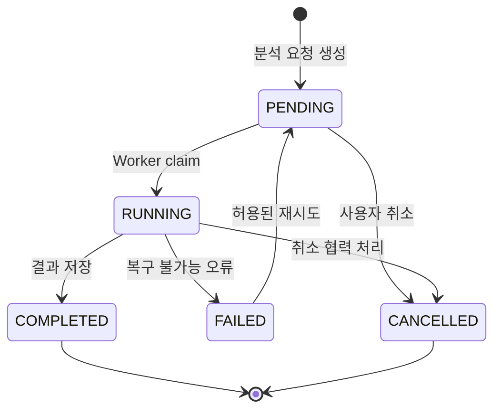

목표 sequence:

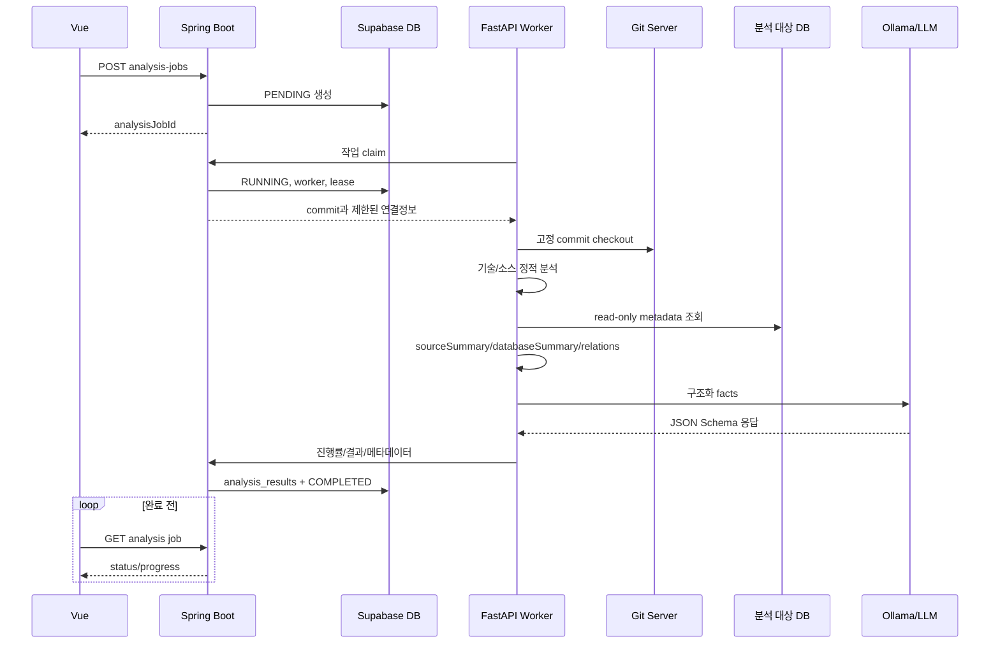

현재 구현은 `PENDING` 생성까지다. Worker sequence는 다음 개발 단계다.

## 10. 분석 데이터 흐름

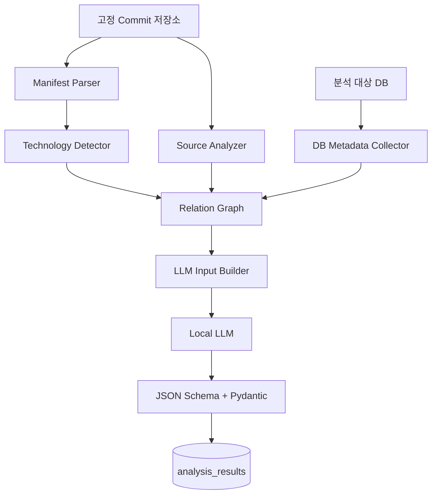

### 기술 탐지

manifest와 marker file을 읽되 분석 대상 저장소의 script는 실행하지 않는다.

금지:

```text
npm install
npm scripts
./gradlew
mvn
setup.py
기타 저장소 내부 실행 파일
```

### 상세 분석 목표

노드:

```text
SCREEN
COMPONENT
ROUTE
API_CLIENT
API_ENDPOINT
CONTROLLER
SERVICE
REPOSITORY
MAPPER
SQL_STATEMENT
DB_SCHEMA
DB_TABLE
DB_COLUMN
```

관계:

```text
ROUTES_TO
CALLS
USES
IMPLEMENTS
EXECUTES
READS
WRITES
REFERENCES
DEPENDS_ON
```

### LLM 입력 원칙

- 원본 저장소 전체를 한 prompt에 넣지 않음
- 정적 분석으로 필요한 facts를 축약
- 파일 경로와 근거 보존
- token/password/private key/ciphertext 제거
- 출력 schema와 낮은 temperature 사용
- 검증 실패는 제한된 횟수만 재시도

## 11. FastAPI와 Ollama

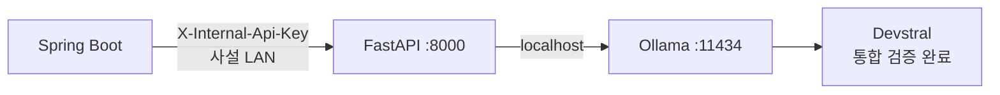

FastAPI API:

```text
GET  /health
GET  /api/models/health
POST /api/analysis/project
```

오류 계약:

| 상황 | HTTP |
|---|---:|
| 내부 API key 실패 | 401 |
| 잘못된 요청/민감정보 포함 | 422 |
| 잘못된 모델 JSON | 502 |
| Ollama 연결 실패 | 503 |
| 모델 미설치 | 503 |
| 모델 timeout | 504 |

환경변수:

```text
DOENAAI_OLLAMA_URL=http://127.0.0.1:11434
DOENAAI_AI_MODEL=devstral
DOENAAI_AI_INTERNAL_API_KEY=
DOENAAI_AI_REQUEST_TIMEOUT_SECONDS=300
DOENAAI_AI_KEEP_ALIVE=30m
DOENAAI_AI_MAX_VALIDATION_RETRIES=1
```

기준 Mac Studio에서 `devstral:latest` 설치와 구조화 JSON 단독 추론을 확인했고,
FastAPI를 통한 실제 분석 요청도 성공했다. 실제 오류 주입에서는 잘못된 Ollama
주소와 미설치 모델이 `503`, 극단적으로 짧은 모델 timeout이 `504`로 변환됐다.
실행과 재검증 명령은 `ai-server/README.md`를 기준으로 관리한다.

## 12. 학습과 모델 배포

```mermaid
flowchart LR
    ORIGINAL["original_result"] --> REVIEW["PL / 개발자 검토"]
    REVIEW --> CORRECTED["corrected_result"]
    CORRECTED --> APPROVE["승인"]
    APPROVE --> FILTER["품질/민감정보 필터"]
    FILTER --> DATASET["training_datasets"]
    DATASET --> JOB["training_jobs"]
    JOB --> LORA["MLX-LM / LoRA"]
    LORA --> VERSION["model_versions"]
    VERSION --> EVAL["model_evaluations"]
    EVAL -->|통과| DEPLOY["model_deployments"]
    DEPLOY --> AI["AI 분석/추론 서버"]
```

모델 운영 원칙:

- 초기에는 사전 학습 모델 사용
- 승인 데이터가 쌓이기 전 파인튜닝하지 않음
- 학습/평가/배포 버전 분리
- 분석 결과에 사용 모델 버전 기록
- 평가를 통과하지 않은 모델은 활성 배포하지 않음

## 13. 데이터 저장 경계

| 데이터 | 저장 위치 | 비고 |
|---|---|---|
| 사용자 계정 | Supabase Auth | 비밀번호는 Supabase 관리 |
| 업무 프로필/권한 | PostgreSQL | Spring Boot 경유 |
| 조직과 조직 구성원 | PostgreSQL | 목표 구조; 현재 미구현 |
| 프로젝트 | PostgreSQL | 목표 구조에서는 조직 소유 |
| 고객 요구사항 | PostgreSQL | 목표 구조; 버전과 공개 범위 포함 |
| 견적과 작업 항목 | PostgreSQL | 목표 구조; 산정 근거와 버전 포함 |
| Git/DB credential | PostgreSQL 암호문 | AES-256-GCM |
| 분석 입력 snapshot | `analysis_jobs` | URL/branch/SHA 등 |
| AI 결과 | `analysis_results` | JSONB |
| 사용자 수정 결과 | `analysis_results.corrected_result` | 원본과 분리 |
| 모델 파일 | 외부/로컬 artifact storage | DB에 binary 저장하지 않음 |
| 모델 메타데이터 | PostgreSQL | version/deployment |

## 14. 네트워크와 보안 경계

```text
Browser -> Supabase Auth        HTTPS
Browser -> Spring Boot          HTTPS 또는 개발 proxy
Spring Boot -> Supabase DB      TLS
Spring Boot -> Supabase JWKS    HTTPS
Spring Boot -> FastAPI          사설 LAN + 내부 인증
FastAPI -> Ollama               localhost
FastAPI -> Git/분석 DB          Worker 구현 시 제한된 outbound
Training -> Supabase/artifact   관리망
```

필수 보안:

- 모든 조직 소유 데이터에 tenant 범위 적용
- Backend query와 RLS에서 조직 경계를 이중 검증
- 고객은 허용된 프로젝트·요구사항·견적만 조회
- 고객 응답에서는 credential, 원본 소스와 내부 전용 분석을 제외
- 인터넷에서 FastAPI/Ollama port forwarding 금지
- Ollama `0.0.0.0:11434` 금지
- FastAPI API key 최소 32자
- API key 비교에 `secrets.compare_digest`
- prompt/payload/API key 로그 금지
- Spring Boot 암호화 키 Git 저장 금지
- 동일 DB 암호문을 복호화하는 Backend는 동일 키 사용
- 분석 임시 디렉터리는 작업 종료 후 삭제
- symbolic link를 따라 저장소 밖으로 나가지 않음
- 분석 대상 코드를 실행하지 않음

## 15. 장애 격리

| 장애 | 영향 | 기대 동작 |
|---|---|---|
| Supabase JWKS timeout | API 인증 실패 | 401/로그, 네트워크 복구 후 재조회 |
| Git 연결 실패 | 프로젝트 분석 시작 실패 | FAILED 원인 저장 |
| 분석 DB 연결 실패 | DB 분석 불가 | 작업 실패 또는 옵션에 따른 부분 결과 |
| FastAPI 중단 | AI 단계 실패 | retry/timeout |
| Ollama 중단 | 모델 호출 불가 | FastAPI 503 |
| 모델 timeout | AI 단계 지연 | FastAPI 504, 제한 retry |
| 잘못된 모델 JSON | 결과 검증 실패 | 제한 retry 후 502 |
| Worker heartbeat 중단 | 작업 고착 | lease 만료 후 재처리 |

조직·요구사항·견적 스키마를 먼저 확정한 뒤, Worker
claim/lease/heartbeat를 후속 분석 파이프라인 migration에서 설계할 예정이다.

## 16. 아키텍처 결정 요약

| 결정 | 이유 |
|---|---|
| 회사·조직별 tenant 경계 | 여러 회사가 같은 서비스 사용 시 데이터 혼합 방지 |
| 고객과 내부 검토 화면 분리 | 고객에게 필요한 결과만 공개하고 기술·비밀정보 보호 |
| AI 견적 자동 확정 금지 | 불완전한 요구와 사업적 판단을 PM/PL이 최종 책임 |
| 브라우저 업무 DB 직접 접근 차단 | 권한과 감사 지점을 Backend로 통합 |
| Spring Boot가 credential 관리 | AI 분석/추론 서버에 암호화 master key 공유 최소화 |
| 정적 분석 후 LLM | 환각 감소, 근거 제공 |
| commit SHA snapshot | 재현성 |
| FastAPI와 Ollama 분리 | 모델 runtime 교체와 API 검증 분리 |
| Ollama localhost | 인증 없는 runtime 보호 |
| 결과 JSON Schema | 서비스 간 안정적인 계약 |
| 원본/수정 결과 분리 | 품질 측정과 학습 데이터 확보 |
| 모델/버전/배포 분리 | 모델 수명주기 추적 |
| 비동기 Worker | 대규모 분석과 재시도 |
