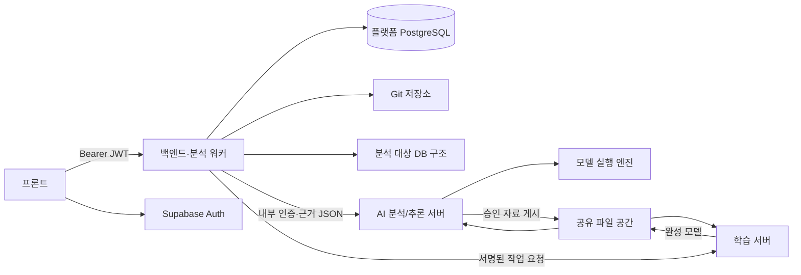
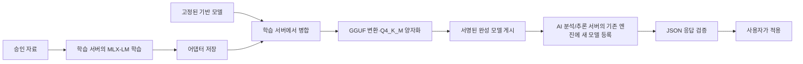

# doenaai 시스템 아키텍처

기준일: 2026-10-21

백엔드가 인증·권한과 작업을 제어하고 Git·DB 근거를 수집한다.
AI 분석/추론 서버는 전달받은 근거로 모델을 호출하며, 학습 서버가 모델 개선을 처리한다.
제품 목적은 [프로젝트 개요](01_프로젝트_개요.md), 배포·검증 현황은
[현재 진행상황](03_현재_진행상황.md)을 따른다.

## 서버 배치와 역할

| 구성요소 | 기준 위치·포트 | 책임 |
|---|---|---|
| 프론트 | 개발 서버 `5173` | 로그인, 입력, 작업 요청과 상태·결과 표시 |
| 백엔드 | 서비스 서버 `8080` | JWT·권한, 조직·프로젝트 접근 검사, 연결정보 암호화, 작업·결과 저장 |
| 분석 워커 | 백엔드와 같은 프로세스 | Git·DB 수집, 정적 근거 구성, AI 분석 요청 |
| AI 분석/추론 서버 | `8000` | 내부 인증, 분석 입력·JSON 응답 검증, 모델 등록·호출 |
| 모델 실행 엔진 | AI 분석/추론 서버의 `127.0.0.1:11434` | 현재 Ollama를 사용해 설치 모델 로딩과 답변 생성 |
| 학습 서버 | `8011` | 자료 수신, MLX-LM 학습, 어댑터 병합과 완성 모델 변환 |
| 공유 파일 공간 | iCloud Drive 공유 폴더 | 승인 학습 자료와 완성 모델 전달; NAS 역할 |
| Supabase | 외부 서비스 | 로그인·JWT, 플랫폼 PostgreSQL |

프론트·백엔드·AI 분석/추론 서버는 같은 장비 또는 서로 다른 장비에 배치할 수 있다.
`localhost`는 각 프로세스가 실행되는 장비를 가리킨다. 분리 배치에서는 호출하는 장비에서
접근 가능한 주소를 설정해야 한다. 현재 모델 실행 엔진은 Ollama지만 업무 화면은
일반적인 설치 모델·모델 실행 환경 용어를 사용한다.



분석 대상 DB와 플랫폼 PostgreSQL은 용도와 권한이 다르다.
AI 모델은 Git·DB 계정을 받아 임의로 코드를 실행하거나 SQL을 수행하지 않는다.

## 분석 처리

1. 사용자가 프로젝트의 Git·DB 연결을 검사하고 저장한 뒤 분석을 요청한다.
2. 백엔드는 권한과 연결을 확인하고 Git 커밋·선택 요구사항 버전을 작업에 고정한다.
3. 요청을 받은 백엔드의 워커가 대기 작업을 선점한다. 다른 백엔드가 대신 처리하지 않는다.
4. 워커가 Git 일반 파일과 읽기 전용 DB 구조를 수집하고 정적 근거를 구성한다.
5. 입력 크기를 제한하고 `sourceSummary`, `databaseSummary`, `relations`를 AI 분석/추론 서버에 전달한다.
6. AI 분석/추론 서버가 일반 분석, 필요한 DB 묶음 분석·종합, 최종 정리를 수행하고 응답을 검사한다.
7. 백엔드는 결과와 실제 전달 근거를 저장하고 작업을 완료한다. 화면은 상태와 저장 결과를 조회한다.

분석 시작 때 선택한 모델은 해당 분석의 모든 단계에서 유지한다.
모델을 전환해도 진행 중인 분석을 다른 모델로 바꾸지 않는다.
학습 모델을 사용한 경우 원래 기반 계열과 실제 실행 모델 식별값을 함께 기록한다.

주요 경로:

```text
POST /api/projects/{projectId}/analysis-jobs
GET  /api/analysis-jobs/{jobId}
GET  /api/analysis-jobs/{jobId}/result
POST /api/analysis/project                 백엔드 → AI 분석/추론 서버
```

작업 상태는 `PENDING` → `RUNNING` → `COMPLETED` 또는 `FAILED`·`CANCELLED`다.
단계 내역과 경과 시간을 확인하며 진행률을 남은 시간으로 해석하지 않는다.
워커의 인스턴스 지정과 재시작 규칙은 [분석 워커 운영](16_분석_워커_지정_운영.md)을 따른다.

### 수집 범위와 시간 제한

- 실제 분석 경로의 수집기는 백엔드 Java 코드다. 별도 Python 기술 탐지기만 수정해도 워커 결과가 바뀌지는 않는다.
- Git은 저장한 커밋의 일반 파일을 읽는다. 프로젝트 스크립트, 빌드, hook, LFS와 submodule을 실행하지 않는다.
- DB는 PostgreSQL·Oracle의 선택 스키마에서 테이블·뷰, 컬럼, PK·FK·인덱스를 읽으며 업무 행은 조회하지 않는다.
- 파일·테이블·관계·입력 길이에는 제한이 있다. 실제 전송 수와 생략된 범위는 `promptCoverage`, `truncated`, `warnings`로 확인한다.
- 백엔드 모델 입력의 기본 상한은 90,000자이며 `DOENAAI_ANALYSIS_MAX_PROMPT_CHARS`로 조정한다.
- AI 호출 제한, 백엔드 전체 대기와 고착 작업 판정은 함께 맞춘다. 여러 단계와 재시도가 있어 단일 호출 제한만큼으로 전체 대기를 설정하면 부족할 수 있다.

`GET /health`는 API 프로세스 확인이다. 인증된 `GET /api/models/health`와 실제 분석 성공까지
보장하지 않는다. 잘못된 내부 인증, 모델 미설치·중단, 응답 형식 오류와 시간 초과는 구분해 처리한다.

## 승인 자료와 학습

1. 사람이 AI 원본을 검토하고 필요한 수정본과 이유를 승인한다.
2. 학습 초안에서 실제 입력으로 답할 수 있는 정답과 비식별화를 확인한다.
3. 확정한 파일을 공유 폴더에 게시하고 서명된 알림으로 학습 서버에 수신을 요청한다.
4. 학습 서버는 동기화된 파일의 크기·해시·응답 계약·승인 표시·근거를 검사한 뒤 수신을 확정한다.
5. 화면의 대상 모델에 대응하는 기반 모델·고정 버전·지원 학습기를 확인한 후 학습한다.

자료는 `sourceModel`로 기반 계열을 구분한다. 새 학습 모델로 생성한 자료의 실제 모델 정보는
`sourceTrainedModel`에 남긴다. 모델 기록이 없는 과거 자료를 임의로 다른 계열에 넣지 않는다.
등록되지 않은 모델이나 지원되지 않는 학습기는 Qwen으로 대체하지 않고 준비되지 않은 상태로 처리한다.

같은 원 요구사항의 수정 버전과 후속 질문은 같은 학습·검증·시험 분할에 둔다.
정답이나 핵심 근거를 길이 상한에 맞춰 잘라 넣지 않으며, 변환된 실제 메시지에서 인용 근거를 다시 검사한다.
일반 단계 입력에 없는 DB 상세를 일반 정답에 넣지 않고 단계별 입력·정답을 맞춘다.
현재 지원 범위와 데이터 절차는 [학습 서버 안내](../training/README.md)와
[데이터 처리 안내](../training/DATA_WORKFLOW.md)를 따른다.

## 학습 결과로 새 모델 생성·적용



- 기반 MLX 모델과 어댑터의 일치·무결성을 확인한 뒤 학습 서버에서 병합·변환한다.
- 생성 작업은 충분한 작업 공간과 고정된 변환 도구를 요구한다. 현재 작업 공간 기준은 180 GiB 이상이다.
- 공유 폴더의 완료 표시만 믿지 않고 서명·크기·해시를 확인한다. 파일 미도착은 동기화 대기로 표시한다.
- AI 분석/추론 서버는 완성 GGUF를 기존 Ollama에 별도 모델로 등록한다. 기존 모델 파일을 덮어쓰지 않는다.
- 등록 완료와 현재 사용 모델 변경은 별도 단계다. JSON 응답을 검증하고 사용자가 적용해야 새 분석에 사용한다.
- AI 분석/추론 서버에는 이 경로를 위한 MLX 환경이나 학습용 기반 모델이 필요 없다. 적용 후 실시간 추론에 학습 서버가 참여하지 않는다.
- 생성·등록 성공과 JSON 검증만으로 업무 품질을 승인하지 않는다. 기존 모델과 같은 조건에서 답변을 비교한다.

화면 절차는 [AI 모델 관리 사용 안내](18_AI_모델_관리_사용_안내.md), 학습 서버의 도구·설정과
실패 대응은 [완성 모델 생성 안내](../training/MODEL_EXPORT.md)를 따른다.

## 인증·저장·운영 경계

| 정보 | 저장·처리 위치 |
|---|---|
| 로그인 계정·세션 | Supabase Auth |
| 조직·프로젝트·요구사항·분석·모델 작업 이력 | 플랫폼 PostgreSQL, 백엔드 권한 검사 |
| Git·DB 비밀값 | 백엔드 암호화 저장; 조회 응답과 모델 입력에서 제외 |
| 사용 모델 선택과 실행 상태 | AI 분석/추론 서버의 로컬 영속 상태 |
| 기반 모델·어댑터·상세 학습 보고서 | 학습 서버의 Git 제외 폴더 |
| 승인 자료와 완성 모델 전달 파일 | 공유 폴더와 각 서버의 검증된 로컬 사본 |

내부 AI API 키와 연결정보 암호화 키는 다른 용도다. 같은 DB 암호문을 사용하는 백엔드는
동일한 암호화 키를 유지해야 한다. 임의 변경하면 기존 연결정보를 읽을 수 없다.
학습 제어·전달에는 별도의 공유 키와 서명을 사용하며 프론트에 비밀 키를 전달하지 않는다.

모델 엔진은 localhost로 제한하고 내부 분석·학습 API를 인터넷에 직접 공개하지 않는다.
분석·학습 임시 파일은 작업별로 정리하되 원본 자료와 기존 모델·결과는 보존한다.
설정 파일과 코드는 장비마다 별도로 반영한다. 커밋·푸시·pull과 서버 재시작은 서로 다른 단계다.
실행 중인 분석·학습·생성이 있으면 재시작 전에 상태를 확인한다.
