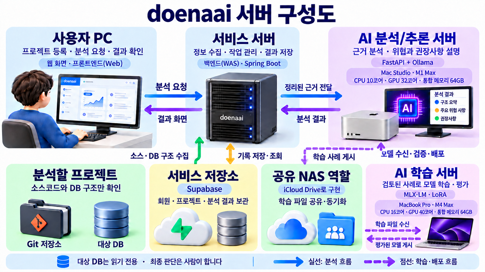
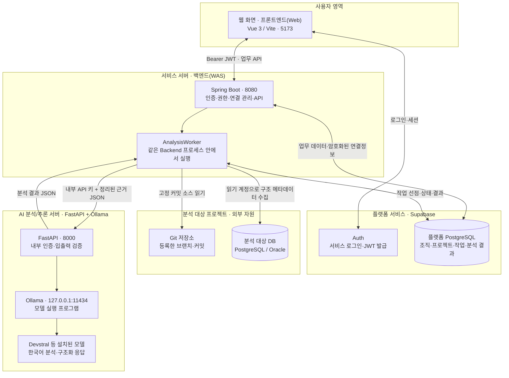
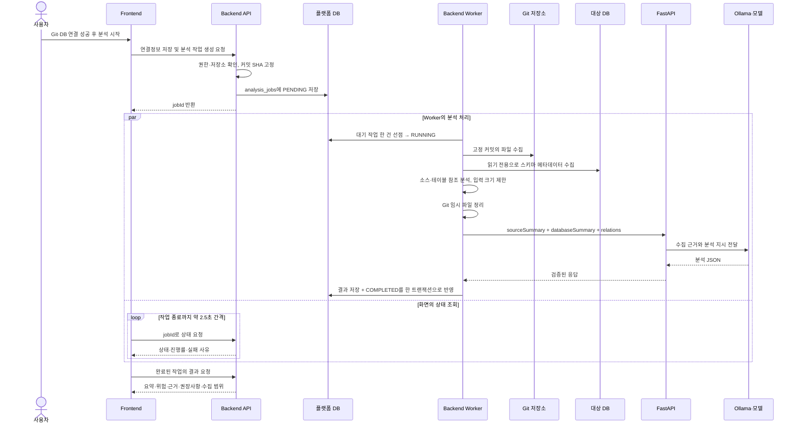

# doenaai 팀원 온보딩 가이드

> 2026-10-14 재점검: 전체 구현 상태는 [03번](03_현재_진행상황.md), Frontend의 실제 API 연결·미완료 화면은 [13번](13_2026-10-14_Frontend_구현_점검.md)을 기준으로 확인한다. 아래 서버·업무 흐름의 기본 설명은 유효하지만 Devstral 당시 기록과 학습 준비 현황은 [10번](10_2026-10-14_AI_모델_선정_근거.md)·[12번](12_2026-10-14_MacBook_학습_도구_진행상황.md)에서 갱신했다.

기준일: 2026-10-12 · 대상: 프로젝트에 새로 합류하는 팀원

이 문서는 **2026-10-12 구현 상태**를 기준으로 프로젝트 목적, 서버 구성,
분석 흐름과 역할 분담을 설명한다. 제품의 최종 목표와 현재 가능한 기능은 구분한다.
팀 개발 시작 전 같은 공유 커밋을 사용하는지 확인한다. 문서가 있다는 것만으로
원격 저장소와 배포 서버까지 반영된 것은 아니므로 Git 이력과 서버 실행 상태를
각각 확인해야 한다.

### 화면과 문서에서 사용하는 명칭

| 공유용 명칭 | 개발 명칭 | 주요 역할 |
|---|---|---|
| 웹 화면 | 프론트엔드(Web) · Vue | 요구사항 입력, 분석 요청, 결과 확인 |
| 서비스 서버 | 백엔드(WAS) · Spring Boot | 인증·권한, 근거 수집, 분석 작업과 결과 관리 |
| AI 분석/추론 서버 | FastAPI + Ollama | 수집된 근거로 모델 추론을 수행하고 분석 결과 반환 |
| AI 학습 서버 | MLX-LM / LoRA | 검토된 사례로 데이터셋 구성과 모델 학습·평가 |

현재 AI 분석/추론 서버의 기준 장비는 Mac Studio, AI 학습 서버의 기준 장비는 MacBook이다.
장비를 교체해도 위 명칭은 유지한다. 웹 서버는 프론트엔드 빌드 파일을 제공하고,
WAS는 백엔드 업무 API를 실행하므로 Vue 자체를 웹 서버라고 부르지는 않는다.

### 한눈에 보는 서버 구성



위 그림은 비개발자 설명용 PNG다. 장비와 역할 중심으로 단순화했으며 로그인 등
세부 통신은 아래 설명을 참고한다. 내장 이미지 생성 도구로 제작했으며,
[명칭 갱신 프롬프트](assets/doenaai-server-roles-prompt.txt)를 함께 보관한다.

| 역할 | 기준 장비와 사양 |
|---|---|
| AI 분석/추론 서버 | Mac Studio · M1 Max · CPU 10코어 · GPU 32코어 · 통합 메모리 64GB |
| AI 학습 서버 | MacBook Pro · M4 Max · CPU 16코어 · GPU 40코어 · 통합 메모리 64GB |
| 공유 NAS 역할 | 별도 NAS 장비 대신 iCloud Drive 공유 폴더로 학습 파일 공유·동기화 |

Mac Studio의 CPU·GPU 코어 수와 메모리는 2026-10-19 장비에서 직접 확인했다.
MacBook Pro 사양은 2026-10-19 사용자가 전달한 장비 확인값을 반영했다.
Ollama는 Apple GPU의 Metal 가속을 지원하고, MLX는 CPU·GPU와 통합 메모리를 활용한다.
뉴럴 엔진 사양을 이 학습·추론 경로의 사용 성능으로 해석하지 않는다.
가속 방식은 [Ollama 공식 문서](https://docs.ollama.com/gpu)와
[Apple MLX 설명](https://developer.apple.com/videos/play/wwdc2025/315/)을 참고한다.

SSH 직접 전송이 어려워 공통 NAS가 있다는 전제로 iCloud Drive 환경을 채택했다.
AI 분석/추론 서버가 검토된 학습 파일을 게시하고, AI 학습 서버가 동기화된 파일을
수신·검증하는 흐름이다. Supabase는 서비스 데이터 저장소로, 이 공유 파일 공간과 구분한다.

아래의 상세 그림 3개는 Mermaid 형식이다. GitHub의 Markdown 보기 또는
Mermaid를 지원하는 Markdown 미리보기에서 그림으로 볼 수 있다.

## 1. 이 프로젝트를 한 문장으로 설명하면

> **doenaai는 고객의 변경 요구사항을 소스코드와 DB 구조에 연결해, 어디를
> 수정해야 하는지와 어떤 위험이 있는지를 설명하고 PM·PL의 견적 작성을 돕는 도구다.**

일반 챗봇처럼 질문만 받고 답하는 것이 아니라, 등록한 프로젝트에서 수집한
근거를 바탕으로 답하도록 만드는 것이 핵심이다. AI가 직접 코드를 수정하거나
DB 구조를 변경하는 시스템은 아니다.

### 해결하려는 문제

- 화면 하나를 바꿀 때 관련 API, 서버 로직, SQL, DB까지 찾는 데 시간이 걸린다.
- 담당자의 기억에 의존하면 숨은 영향 범위와 회귀 테스트가 빠질 수 있다.
- PM이 작업량·기간·비용을 설명할 때 기술적인 판단 근거가 부족하다.
- 기존 분석과 검토 결과가 다음 작업에 활용되지 못한다.

### 지향하는 업무 흐름


이 그림은 **최종 제품의 업무 목표**다. 현재는 그중 근거 수집과 AI 분석 경로를
구현했고, 요구사항 현재 버전의 분석 요청 UI도 연결했다. 과거 버전 선택·상세
영향 그래프·견적 업무의 완성은 남아 있다.
AI의 위험 점수나 제안은 참고자료이며, 최종 범위와 견적은 사람이 결정한다.

### 팀원에게 설명할 때 사용할 예시

“회원 탈퇴 시 데이터를 즉시 삭제하지 않고 30일 보관하도록 바꾸고 싶다”는
요청이 들어왔다고 가정한다. 궁극적으로는 관련 화면, 탈퇴 API, 서버 로직,
회원 테이블, 삭제 배치, 보관 정책, 테스트 항목을 찾아 설명하는 것이 목표다.
**이 예시는 제품 목표 설명용이며 현재 시스템의 실제 분석 결과는 아니다.**

## 2. 서버 구성도 — 지금 실제로 연결되는 구조



**가장 중요한 경계: Git와 대상 DB에 접속하는 주체는 Backend다.**
FastAPI나 모델에 DB 비밀번호를 주고 자유롭게 SQL을 실행시키는 구조가 아니다.
Backend가 필요한 구조 정보를 수집하고, FastAPI는 전달받은 근거로 모델을 호출한다.

그림의 두 DB는 역할이 다르다.

- **플랫폼 DB:** doenaai 자체의 회원 프로필, 프로젝트, 분석 작업과 결과를 저장한다.
- **분석 대상 DB:** 고객 또는 테스트 프로젝트의 구조를 읽는 대상이다.

개발 중 같은 Supabase 인스턴스를 두 용도로 사용하더라도 접속 목적과 권한은
분리해야 한다. 플랫폼 업무 계정과 대상 DB의 읽기 계정을 서로 대체하면 안 된다.

### 서버별 역할

| 구성요소 | 하는 일 | 하지 않는 일 |
|---|---|---|
| 웹 화면 · 프론트엔드(Web) | 로그인, 조직·프로젝트 입력, 연결 테스트 요청, 상태·결과 표시 | DB 비밀번호 영구 보관, 모델 직접 호출, 최종 권한 판정 |
| 서비스 서버 · 백엔드(WAS) | JWT·권한 확인, 조직/프로젝트 접근 제어, 연결정보 암호화, 작업·결과 관리 | 모델 자체의 토큰 생성 |
| Backend Worker | Git 읽기, DB 구조 수집, 소스 참조 탐지, AI 요청, 결과 저장 | 대상 저장소 코드 실행, 대상 DB 데이터 수정 |
| Supabase Auth | 서비스 로그인과 세션/JWT 제공 | 분석 대상 DB 읽기 계정 인증의 대체 |
| 플랫폼 PostgreSQL | 조직·프로젝트·연결정보·작업·결과 저장 | 모델 추론 |
| AI 분석/추론 서버 · FastAPI | 내부 API 키 검사, 입력 검증, 프롬프트 구성, Ollama 호출, 응답 검증 | 현재 분석 경로에서 Git/대상 DB 직접 접속 |
| Ollama + 모델 | 설치된 모델을 로드하고 답변 생성 | 서비스 회원·조직·Git·DB 권한 관리 |
| AI 학습 서버 | 검토한 사례 수신·검사, 데이터셋 구성, 모델 학습·평가 | 운영 사용자 요청의 실시간 추론 처리 |

Ollama는 모델 실행 프로그램, Devstral은 그 프로그램이 실행하는 학습된 모델,
FastAPI는 우리 서비스와 모델을 연결하는 Python API다. **세 가지는 서로 다르다.**

### 로그인은 분석과 별도의 흐름이다

1. Vue 로그인 화면에서 Supabase Auth로 로그인한다.
2. Auth가 반환한 JWT를 Frontend가 Backend 요청에 붙인다.
3. Backend가 JWT, 활성 프로필, 역할/권한, 조직·프로젝트 접근 범위를 확인한다.
4. 업무 데이터는 Backend를 통해 조회한다. 브라우저가 플랫폼 업무 테이블에
   직접 접속하거나 대상 DB 계정으로 로그인하는 구조가 아니다.

새 회원은 현재 migration의 기본 역할이 `VIEWER`다. **회원 계정을 만들었다고
프로젝트 생성·분석 권한이나 조직 가입까지 자동으로 생기지는 않는다.** 팀원별로
서비스 역할/권한과 조직·프로젝트 소속을 확인한다. 이러한 검사가 있다는 것과
멀티테넌트 상용 운영 보안 검증이 완료되었다는 것은 구분해야 한다.

## 3. 분석 시작 버튼을 누르면 어떤 일이 일어나는가



위 순서도는 성공 경로이며, 상태 조회는 실제로 Worker 처리와 **동시에** 진행된다.
어느 단계에서든 실패하면 작업은 `FAILED`로 기록되고 화면의 자동 조회는 멈춘다.
작업 생성 요청도 Git 연결 재확인을 포함하므로 반환까지 짧은 대기가 있을 수 있다.

### 작업 상태와 진행률을 읽는 방법

| 상태/표시 | 의미 |
|---|---|
| `PENDING` | 작업이 저장되었고 Worker가 가져가기를 기다리는 중 |
| `RUNNING` | Git/DB 수집, 참조 분석 또는 AI 응답 처리 중 |
| 80% | 소스 100·DB 100·관계 40의 평균. AI 입력 준비부터 응답 대기 구간에 나타남 |
| `COMPLETED` | 분석 결과와 실제 전달 근거가 저장됨 |
| `FAILED` | 실패한 단계의 안내를 확인하고 원인을 해결한 뒤 새 분석 필요 |

진행률은 남은 시간의 비율이 아니다. 80%에서 오래 머문다고 곧바로 중단된 것은
아니며, 반대로 실패 표시가 나온 작업이 기다린다고 다시 실행되지는 않는다.
`상태 다시 확인`은 조회이고 재분석이 아니다.

### 현재 분석 API

| 호출 주체 | API | 용도 |
|---|---|---|
| Frontend → Backend | `POST /api/projects/{projectId}/analysis-jobs` | 새 작업 생성 |
| Frontend → Backend | `GET /api/analysis-jobs/{jobId}` | 상태 조회 |
| Frontend → Backend | `GET /api/analysis-jobs/{jobId}/result` | 완료 결과 조회 |
| Backend → FastAPI | `POST /api/analysis/project` | 내부 AI 분석 요청 |
| 운영 점검 → FastAPI | `GET /health` | API 프로세스 상태 확인, 인증 없이 조회 가능 |
| 운영 점검 → FastAPI | `GET /api/models/health` | 내부 키 인증 후 모델 가용성 확인 |

`/health`가 정상이어도 내부 API 키, 모델 상태, 실제 추론 성공까지 보장하지 않는다.

## 4. AI가 무엇을 보고 답하는가

현재 FastAPI 입력은 `projectId`, `sourceSummary`, `databaseSummary`, `relations`다.

| 근거 묶음 | 포함되는 정보 |
|---|---|
| 소스 요약 | 탐지한 언어·프레임워크·빌드 도구, 구성요소 경로, 커밋 SHA, 탐지 경고 |
| DB 요약 | 선택 스키마의 테이블/뷰, 컬럼 이름·타입·null 허용, PK/FK, 인덱스 |
| 소스–DB 관계 | SQL·명시적 ORM 매핑으로 찾은 테이블 참조, 파일·줄 번호, 신뢰도·불확실성 |
| 선택적 요구사항 | 지정한 요구사항 버전의 제목·정제 내용·인수 조건 |

Backend는 소스 원문 전체, DB 업무 행, 접속 비밀번호를 이 입력에 넣지 않는다.
FastAPI는 요약, 위험 수준/점수, 영향 영역, 근거, 권장사항을 JSON으로 반환한다.
위험 점수는 모델의 판단 값이며 객관적인 결함률이나 확정 견적이 아니다.

### 구조 분석과 변경 영향 분석의 차이

- **프로젝트 구조 분석:** “이 프로젝트가 어떤 기술·DB 구조를 가지며 어디에
  확인할 위험이 있는가?”를 본다. 현재 등록 화면에서 시작하는 분석이다.
- **특정 변경의 영향 분석:** “이 요구사항을 적용하면 무엇이 바뀌는가?”를 본다.
  실제 API 모드의 변경요청 관리 화면에서 현재 요구사항 버전을 선택하면
  생성 API에 `requirementVersionId`를 전달한다. 프로젝트 등록 화면은 계속
  전체 구조 분석을 시작한다. 과거 버전 선택 UI와 실제 결과 검증은 남아 있다.

### 데이터가 적어도 시작할 수 있는 이유

현재 방식은 이미 학습된 모델에 프로젝트 근거를 넣어 **추론**하는 것이다.
프로젝트를 등록할 때마다 모델을 새로 학습시키는 것이 아니다.
따라서 해커톤 시작을 위해 임시 데이터를 대량으로 만들어 학습시킬 필요는 없다.
우선 작은 테스트 프로젝트에서 근거와 답변의 정확도를 검증한다.

팀의 검수 결과를 모아 모델을 개선하는 학습은 향후 과제다.
`training/`의 데이터 추출·LoRA 스크립트는 현재 placeholder이며 분석 실행의
필수 구성요소가 아니다.

## 5. 현재 구현 범위와 아직 남은 부분

| 영역 | 현재 상태 | 남은 확인/개발 |
|---|---|---|
| 로그인·권한 | Supabase 로그인, Backend JWT/RBAC, 조직·프로젝트 접근 검사 구현 | 팀원 계정별 권한과 실제 사용 시나리오 점검 |
| 프로젝트 연결 | 조직 선택, Git/DB 연결 테스트·암호화 저장 구현 | 환경별 네트워크·계정 설정 |
| Git 수집 | 기록한 커밋의 일반 파일을 제한된 범위에서 추출 | 대형 저장소·여러 프로젝트 검증 |
| 대상 DB 수집 | PostgreSQL/Oracle의 선택 스키마 구조 수집 구현 | 다른 DB 종류는 별도 드라이버·수집 검증 필요 |
| 소스 탐지 | 여러 언어/manifest 탐지, SQL·명시적 ORM 테이블 참조 수집 | 모든 언어·프레임워크를 완벽하게 해석하는 것은 아님 |
| Worker·AI·결과 | 큐 선점→수집→AI 요청→결과 저장 경로 구현 | 실제 등록 프로젝트의 최종 성공 재확인 |
| 실제 결과 화면 | 상태, 요약, 위험, 근거, 권장사항, 수집 범위 표시 구현 | 사용자 검토·피드백 업무 확장 |
| 요구사항 | Backend 생성·조회·버전·상태 변경 API와 현재 버전 분석 시작 UI 구현 | 과거 버전 선택·수정 UI, 실제 변경 영향 분석 검증 |
| 상세 아키텍처·영향 화면 | 별도 화면에 Mock 데이터가 남아 있음 | 실제 결과/관계 그래프로 연결 |
| 견적 | DB 테이블 설계 기반 존재 | 견적 서비스·UI·검토·승인 업무 구현 |
| 모델 학습·RAG | 향후 확장 방향 | 검수 데이터, 평가, 검색/분할, 학습 파이프라인 |

**현재 전체 호출 그래프를 완성한 상태는 아니다.** 화면→API→Service→SQL→DB의
모든 연결, 동적 SQL, 암묵적 ORM 이름, 컬럼별 사용 위치를 완전히 추적하지 못한다.
자동 탐지된 프레임워크 이름이 있다는 것과 그 기술의 모든 관계를 해석한다는 것은 다르다.

스캔은 파일 수·크기·테이블 수·시간 제한이 있다. 모델 입력도 기본 최대 90,000자로
줄이며 전달되지 않은 범위는 `promptCoverage`, `truncated`, `warnings` 등으로
기록한다. **“찾지 못했다”를 “영향이 없다”로 해석하면 안 된다.**

실제 프로젝트의 구조 분석은 2026-10-12 오후에 완료 상태와 결과 저장을 확인했다.
그 결과에는 테이블 26/26개와 관계 81/81개가 입력 범위로 표시됐다. 다만 이는
근거의 정확성을 보증하지 않으며, 요구사항을 지정한 변경 영향 분석은 아직
실제 환경에서 검증하지 않았다. 따라서 전체 제품 흐름 검증 완료로 소개하지 않는다.

## 6. 계정과 DB 테이블 — 혼동하기 쉬운 부분

| 구분 | 용도/저장 위치 | 주의점 |
|---|---|---|
| 웹사이트 로그인 회원 | `auth.users`, 프로필은 `public.profiles` | 분석 대상 DB 읽기 계정과 무관 |
| 조직과 구성원 | `public.organizations`, `public.organization_members` | 소속 조직과 프로젝트 범위 확인 |
| 프로젝트와 구성원 | `public.projects`, `public.project_members` | 분석의 접근 범위 기준 |
| Git 접속정보 | `public.project_repository_connections` | 인증정보는 `credential_ciphertext`에 암호화 |
| 대상 DB 접속정보 | `public.project_database_sources` | `username`과 암호화된 `credential_ciphertext` 저장 |
| 분석 작업 | `public.analysis_jobs` | 상태, 진행률, 커밋, 오류 단계 |
| 분석 결과 | `public.analysis_results` | AI 원본 결과와 실제 모델에 보낸 근거 |
| 요구사항과 버전 | `public.requirements`, `public.requirement_versions` | 특정 변경 분석의 기준 |
| 견적 설계 | `public.estimates`, `public.estimate_items`, `public.estimate_reviews` | 테이블 존재와 업무 기능 완성은 별개 |

읽기 계정 자체는 대상 PostgreSQL/Oracle에 생성하는 DB 사용자/역할이다.
`project_database_sources`에 정보를 저장한다고 대상 DB에 새 계정이 생성되는 것은 아니다.

추가로 구분해야 할 설정:

- **플랫폼 DB 접속 자격증명:** Backend가 doenaai 업무 데이터를 저장할 때 사용한다.
- **내부 AI API 키:** Backend↔FastAPI 호출 인증용이다. 두 서버에 같은 값을
  설정하며 32자 이상이어야 한다. 모델 프롬프트나 Frontend에 넣지 않는다.
- **연결정보 암호화 키:** 저장된 Git/DB 비밀값의 암복호화용이다. 내부 AI API
  키와 다르며, 임의로 바꾸면 기존 연결정보를 읽을 수 없게 된다.

실제 키·비밀번호·토큰은 문서, Git, 이슈, 스크린샷에 포함하지 않는다.
민감 필드 차단은 모든 자유 입력 문자열의 비밀값을 탐지하는 장치가 아니므로,
요구사항 본문에도 비밀값을 적지 않는다. 읽기 전용 연결 검증과 별개로 대상 계정
자체에도 최소 권한을 부여해야 한다.

## 7. 팀원 PC와 Mac을 나누어 실행하는 방법

### 기본 배치

- **팀 개발 PC/서비스 서버:** Frontend와 Spring Boot 실행.
- **Mac Studio:** Ollama와 FastAPI 실행.
- **Supabase:** 로그인과 플랫폼 DB 제공.
- **분석 대상 자원:** Backend에서 Git와 대상 DB에 접근할 수 있어야 함.

모두 한 Mac에서 실행해도 되지만, 다른 PC로 나누면 `localhost`는 각각 자기
PC를 뜻한다. 다른 PC의 Backend에 `http://localhost:8000`을 설정하면 Mac으로
접속하지 않는다. Mac의 접근 가능한 주소를 사용해야 한다.

| 설정/포트 | 설정 위치와 확인 사항 |
|---|---|
| `VITE_AUTH_MODE=supabase` | 실제 Supabase 로그인 사용. Frontend Supabase URL/공개 클라이언트 키 설정도 필요 |
| `VITE_AUTH_PROFILE_SOURCE=backend` | 실제 Backend에서 회원 프로필과 권한 조회 |
| `VITE_USE_MOCK=false` | Frontend의 실제 API 모드. 변경 후 Vite 재시작 |
| Frontend 5173 → Backend 8080 | 현재 Vite `/api` 프록시는 Vite 실행 PC의 `localhost:8080`을 바라봄. 두 프로세스를 다른 PC에 두면 프록시/API 주소도 맞춰야 함 |
| `DOENAAI_AI_BASE_URL` | Backend에서 접속 가능한 FastAPI 주소. 다른 PC면 Mac 주소 사용 |
| `DOENAAI_AI_INTERNAL_API_KEY` | 호출 Backend와 Mac FastAPI에 같은 값 설정 |
| `DOENAAI_CREDENTIAL_ENCRYPTION_KEY` | 같은 저장 자격증명을 사용하는 승인된 Backend끼리 일치해야 함 |
| `DOENAAI_ANALYSIS_WORKER_ENABLED` | 분석 담당 Backend만 `true`, 나머지 팀원 Backend는 `false` 권장 |
| FastAPI 8000 | Backend가 접근할 수 있는 내부/VPN 경로만 허용 |
| Ollama 11434 | Mac의 `127.0.0.1` 전용 유지. 팀원 PC에 직접 공개할 필요 없음 |

Backend의 `application-local.yml`에 주소/키가 직접 지정되어 있으면,
기본 `application.yml`의 환경변수 참조보다 그 프로필 설정이 우선할 수 있다.
파일 한 곳에 값을 넣었다고 적용되었다고 가정하지 말고 실제 활성 프로필과
실행 환경변수를 함께 확인한다.

장소가 다르면 사설 IP만 공유해서는 연결되지 않을 수 있다. 팀이 관리하는 VPN
또는 접근 제어된 안전한 통신 경로를 먼저 정하고, 내부 API나 Ollama를 인증 없이
인터넷에 공개하지 않는다. 내부 API 키는 호출 인증일 뿐 HTTP 내용을 암호화하지
않으므로, 외부 구간에는 승인된 VPN 또는 HTTPS를 사용한다.

### 공동개발에서 특히 중요한 실행 규칙

1. 같은 플랫폼 DB를 사용하면 여러 Backend가 같은 분석 큐를 본다.
2. Worker 기본값은 `true`이므로 팀원 PC를 켜는 것만으로 작업을 가져갈 수 있다.
3. 큐 선점은 중복 처리를 막지만, 여러 Worker가 서로 다른 작업으로 한 모델을
   동시에 호출하는 것까지 전역적으로 제한하지는 않는다.
4. 해커톤 기준으로 **분석 담당 Backend 한 개만 Worker를 켠다.** 나머지는
   `DOENAAI_ANALYSIS_WORKER_ENABLED=false`로 실행한다.
5. 가능하면 일상 개발 DB와 공동 시연 DB를 분리하고, 기존 연결정보의 암호화 키를
   각자 재생성하거나 공용 DB에 테스트 데이터를 무분별하게 넣지 않는다.

### 분석 시연 전 체크리스트

- [ ] 팀원이 같은 공유 커밋을 사용한다. 로컬 미커밋 기능의 누락이 없다.
- [ ] 기존 Supabase migration `001`~`007`이 적용되어 있다. 최신 Worker 때문에 새 SQL이 필요한 것은 아니다.
- [ ] 서비스 로그인, 조직 선택, 프로젝트 접근 권한이 정상이다.
- [ ] Git와 DB 연결 테스트를 각각 통과하고 변경한 연결정보를 저장했다.
- [ ] Ollama와 설정한 모델이 준비되어 있고 FastAPI가 실행 중이다.
- [ ] `/health`뿐 아니라 내부 인증과 모델 가용성도 확인했다.
- [ ] 분석 담당 Backend의 AI 주소/키가 맞고 Worker가 켜져 있다.
- [ ] Frontend는 Mock이 아닌 실제 API 모드다.
- [ ] 새 분석 한 건을 실행해 `COMPLETED`와 저장된 근거를 확인한다.
- [ ] 실제 파일/테이블과 결과를 대조하고 누락·불확실성 경고도 검토한다.

실행 명령과 상세 한도는 [분석 Worker 인수인계](06_2026-10-12_분석_Worker_구현_인수인계.md)를 참고한다.

## 8. 팀원별로 어디를 보면 되는가

다음은 담당자가 정해지지 않았을 때 사용할 **역할 분담 제안**이다.

| 담당 영역 | 우선 읽을 경로 | 다음 작업 제안 |
|---|---|---|
| Frontend | `frontend/src/views/ProjectRegisterView.vue`, `AnalysisProgressView.vue`, `frontend/src/api/analysisApi.js` | 과거 요구사항 버전 선택·수정, 실제 결과 기반 상세 화면 |
| Backend/수집 | `backend/src/main/java/com/doenaai/analysis/`, `project/connection/` | 오류 분류·진단 개선, 호출/컬럼 관계 확대, 통합 시나리오 검증 |
| AI 분석/추론 서버 | `ai-server/app/routers/analysis.py`, `app/services/llm_service.py`, `app/models/analysis.py` | 동일 근거로 모델 품질·한국어·지연시간 평가, 근거 밖 추측 점검 |
| DB/인증 | `supabase/migrations/`, Backend `organization/`, `requirement/`, `config/` | 최소 권한, 조직 격리, 테스트 데이터·마이그레이션 관리 |
| PM/QA | 본 문서와 분석 결과 화면 | 데모 시나리오·정답 근거·완료 기준 정의, 실제 결과 대조 |

Backend 주요 클래스의 연결:

```text
AnalysisJobService               작업 생성 및 저장소/요구사항 확인
  → AnalysisJobRepository        대기 큐, 선점, 진행률, 실패 상태
  → AnalysisWorker               전체 처리 순서 제어
      → GitRepositoryConnectionService    고정 커밋 파일 수집
      → DatabaseMetadataCollector         읽기 전용 DB 구조 수집
      → SourceEvidenceCollector           기술·소스/테이블 참조 탐지
      → AnalysisPromptBuilder             민감 필드 차단, 근거 축약
      → AiAnalysisClient                  FastAPI 호출 및 결과 검증
      → AnalysisResultRepository          결과/근거/완료 상태 저장
  → AnalysisResultService/Controller      프로젝트 권한을 검사한 결과 조회
```

Backend의 Java 수집기가 현재 실제 Worker 경로다. 기존 Python 기술 탐지기는
독립 도구로 남아 있으므로, Python 탐지 규칙만 바꾸어서는 현재 Worker 결과가
바뀌지 않을 수 있다.

## 9. 해커톤에서 먼저 완성할 한 가지 흐름

범위를 넓히기 전에 아래 한 흐름을 재현 가능하게 만드는 것을 권장한다.

1. 작은 테스트 프로젝트와 DB를 등록한다.
2. 구조 분석이 실제로 완료되고 Git 커밋·DB 구조·파일 참조를 확인한다.
3. 변경 요구사항 하나를 버전으로 만들고 분석 요청에 연결한다.
4. “어디를 확인/수정해야 하는지, 왜 위험한지, 무엇을 테스트할지”를 근거와 함께 보여준다.
5. 개발자가 누락과 오답을 검토하고 PM이 견적 판단에 활용할 메모를 남긴다.

성공 기준은 답변이 길거나 모델이 큰 것이 아니라 **프로젝트의 실제 근거와
답변이 일치하고, 모르는 범위를 숨기지 않으며, 팀원이 같은 결과를 검증할 수 있는 것**이다.

## 10. 문서 읽는 순서와 기준

1. **이 문서:** 팀원에게 프로젝트를 설명하는 입문 자료.
2. [분석 Worker 인수인계](06_2026-10-12_분석_Worker_구현_인수인계.md): 최신 실행 경로, 한도, API, 검증 기록.
3. [프로젝트 개요](01_프로젝트_개요.md): 제품의 장기 목표와 상세 배경.
4. [시스템 아키텍처](02_시스템_아키텍처.md): 초기 설계 배경. Worker 위치 등 과거 설명에 주의.
5. [다른 PC Backend 인수인계](04_다른_PC_Backend_작업_인수인계.md): 환경 준비의 상세 참고.

이 문서의 구현 판정 근거는 현재 `AnalysisWorker`, `AnalysisPromptBuilder`,
`SourceEvidenceCollector`, `DatabaseMetadataCollector`, `AnalysisProgressView`,
FastAPI 입력/출력 모델과 migration SQL이다. 과거 문서와 충돌하면 최신 코드와
`06`·`07` 문서를 기준으로 확인한다.
