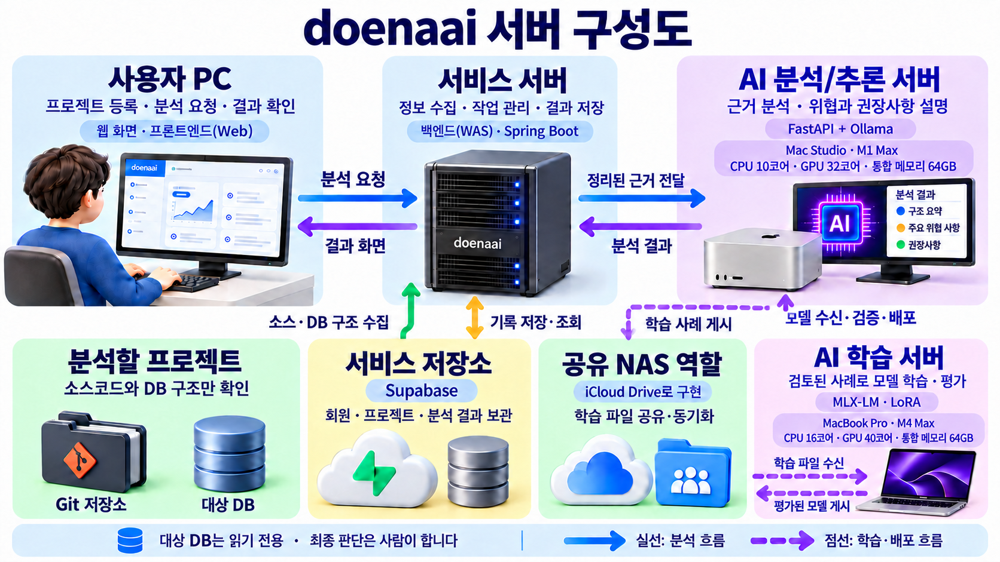
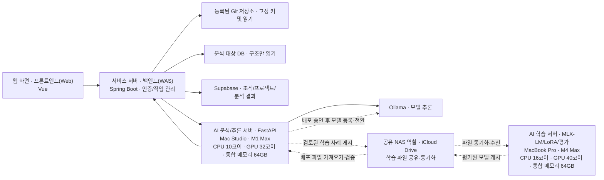

# doenaai AI 분석/추론 서버와 AI 학습 서버 인수인계

> 2026-10-14 MacBook 실행·데이터 도구 갱신: [12번 진행상황](12_2026-10-14_MacBook_학습_도구_진행상황.md)에 Qwen 로딩·QLoRA 시험과 승인 데이터 변환·평가 도구 구현을 기록했다. 실제 업무 학습·품질 개선·배포는 아직 완료하지 않았다.

기준일: 2026-10-13 · 상태: 로컬 작업 내용 포함, 운영 배포 및 학습 완료 문서가 아님

> 2026-10-14 모델 선택 갱신: 이 문서의 Devstral 표기는 작성 당시 상태다. 현재 분석 기본 모델은 Qwen3.8 27B로 결정했다. 비교 근거와 한계는 [AI 모델 선정 근거](10_2026-10-14_AI_모델_선정_근거.md)를 먼저 확인한다.

## 1. 프로젝트가 하려는 일

doenaai는 고객의 변경 요구사항을 등록된 Git 소스와 **읽기 전용으로 수집한 DB 구조**에 연결해 변경 후보, 근거, 위험을 제안한다. PM·PL과 개발자가 이를 검토해 작업 범위와 견적을 결정한다. AI가 대상 코드를 수정하거나 DB에 변경 SQL을 실행하는 제품은 아니다.

## 2. AI 분석/추론 서버와 AI 학습 서버의 역할

| 장비 | 서버 역할 | 처리 내용 |
|---|---|---|
| M1 Max Mac Studio, 64GB 통합 메모리 | AI 분석/추론 서버 | FastAPI, Ollama, Devstral로 분석 요청 처리 |
| MacBook Pro M4 Max, CPU 16코어·GPU 40코어·통합 메모리 64GB | AI 학습 서버 | 승인된 분석 결과로 데이터셋 구성, MLX-LM/LoRA 학습·평가 |

AI 학습 서버는 운영 분석 요청을 직접 처리하지 않고, 평가된 모델을 AI 분석/추론 서버에 전달하는 별도 역할이다. 현재 기준 장비가 각각 MacBook과 Mac Studio이며, 구현·검증 현황은 4절에서 구분해 적었다.

위 PNG는 비개발자 설명용이다. **실선은 분석 요청·결과 흐름, 점선은 학습 데이터·모델 배포 흐름**을 뜻한다. [명칭 갱신 프롬프트](assets/doenaai-server-roles-prompt.txt)도 함께 보관했다. 아래 Mermaid 그림은 같은 구성을 텍스트로도 확인할 수 있게 한 것이다.

구성도는 2026-10-19 기준으로 장비 사양과 공유 파일 경로를 갱신했다.
공유 NAS는 별도 NAS 장비가 아니라 iCloud Drive 공유 폴더로 구현한다.
SSH 직접 전송이 어려운 환경에서 공통 NAS를 사용하는 전제로 채택했으며,
Supabase의 서비스 데이터 저장과 학습 파일 동기화는 서로 다른 경로다.
Mac Studio는 장비에서 CPU 10코어·GPU 32코어·통합 메모리 64GB를 확인했다.
MacBook Pro의 CPU 16코어·GPU 40코어·통합 메모리 64GB는 2026-10-19 사용자가 전달한 장비 확인값이다.

모델 배포 경로는 2026-10-19 채택한 방침을 표시한 것이다. PNG와 Mermaid 모두
직접 SSH 연결이 아닌 공유 NAS 경유 모델 배포 흐름을 표시한다.
자동 배포의 구현 여부와 안전장치는 [모델 배포 방침](../training/MODEL_DELIVERY.md)을 따른다.

Git와 대상 DB에 접속하는 주체는 **Backend Worker**다. AI 분석/추론 서버와 Devstral은 전달받은 사실을 분석하며 대상 DB 비밀번호를 받거나 직접 SQL을 실행하지 않는다. 웹 로그인용 Supabase Auth 계정, 플랫폼 DB, 분석 대상 DB의 읽기 전용 계정은 서로 다른 역할이다.

## 3. 현재 변경 요구사항 분석 흐름

1. 사용자가 프로젝트와 요구사항 버전을 지정해 분석 작업을 생성한다.
2. Backend Worker가 Git 소스와 대상 DB 메타데이터를 수집하고, 소스–테이블 참조를 정적 분석한다. 입력은 크기 제한과 민감 필드 검사를 거친다.
3. AI 분석/추론 서버가 Devstral에 **전체 영향 분석**을 요청한다. 이 응답에는 DB 관련성 판단(`RELATED`, `UNRELATED`, `UNCERTAIN`)도 포함된다.
4. 명확히 `UNRELATED`이면 DB 전용 모델 호출을 생략하고 결과에 `NOT_APPLICABLE` 및 이유를 넣는다. `RELATED` 또는 `UNCERTAIN`이면 요구사항과 테이블·컬럼·PK/FK·인덱스를 추려 **DB 영향 분석**을 한 번 더 요청한다.
5. DB 답변은 `CHANGE_REQUIRED`, `NO_CHANGE`, `NEEDS_CLARIFICATION`, `UNKNOWN` 등으로 구분한다. 불확실한 경우 확정 변경안 대신 조건별 가능성과 확인 질문을 제시한다. AI 분석/추론 서버와 Backend가 형식 및 일부 근거 일치 여부를 검사한 뒤 결과를 저장한다.

요구사항을 지정하지 않은 **프로젝트 구조 분석**은 전체 분석 한 번만 수행하며 DB 변경 판단은 `NOT_APPLICABLE`이다. 요구사항에 `DB`라는 단어가 없다고 곧바로 무관하다고 보지 않는다. 전체 분석이 애매하다고 판단하면 DB 분석을 생략하지 않는 보수적 분기다. 단, 관련성 판단도 모델의 출력이므로 모든 영향 누락을 방지한다고 보장할 수 없다.

예를 들어 저장 동작은 그대로이고 버튼 색상·간격만 바꾸는 요구사항은 DB 호출을 건너뛸 수 있다. 반면 “프로젝트를 하나의 팀만 관리”처럼 팀·조직의 관계가 불명확한 요구사항은 DB 구조를 확인하고, **팀이 기존 조직과 같은 개념인지 별도 개념인지** 질문해야 한다. 현재 스키마만으로 업무 용어의 의미를 확정하거나 임의의 migration을 적용해서는 안 된다.

## 4. 검증된 내용과 아직 검증되지 않은 내용

| 항목 | 현재 확인 결과 |
|---|---|
| DB와 무관한 변경의 분기 | 버튼 색상·간격 변경 샘플로 실제 Devstral 호출을 확인했다. `NOT_APPLICABLE`이 반환됐고 DB 전용 호출은 생략됐다. |
| 분기·응답 검증 자동 테스트 | AI 분석/추론 서버 pytest 38개, Backend Gradle 전체 테스트, Frontend 빌드가 통과했다. 이는 모델의 모든 답변이 정확하다는 뜻은 아니다. |
| DB 영향 분석의 실모델 품질 | Devstral이 조직 외래 키에 부적절한 `UNIQUE` 제약을 제안하거나 핵심 질문을 빗나간 사례가 있었다. 이를 거부하고 재요청하는 검사를 추가했지만, 마지막 DB 전용 시험은 300초 제한으로 종료됐다. **안정적 성공을 확인하지 못했다.** |
| 학습 파이프라인 | `training/export_dataset.py`, `training/train_lora.py`는 placeholder다. 승인 데이터 추출·LoRA 학습·평가·배포는 아직 실행할 수 없다. |

이번 분석 분기 변경은 로컬 소스에 반영된 상태다. 기존에 저장한 분석 결과는 자동으로 바뀌지 않는다. 새 흐름을 실제 프로젝트에서 확인하려면 **AI 분석/추론 서버와 Backend를 재시작하고 새 분석 작업을 생성**해야 한다. 이 문서 작성만으로 Git 커밋·푸시 또는 서버 배포가 완료되는 것은 아니다.

## 5. MacBook 학습이 속도에 미치는 영향

MacBook에서 LoRA를 학습하기만 해서는 Mac Studio의 **토큰 생성 속도**가 자동으로 올라가지 않는다. 현재 계획은 학습과 운영 추론을 서로 다른 장비에서 수행하는 구조다. 검증된 학습 결과를 Mac Studio에 배포한 뒤에도 같은 크기의 모델을 사용한다면 추론 속도는 별도로 측정해야 한다.

간접적인 속도 개선 가능성은 있다. 더 정확한 답변으로 재시도를 줄이거나, 관련 자료만 검색해 모델 입력을 줄이면 최종 결과까지의 시간이 짧아질 수 있다. 반대로 검색 단계·큰 입력·추가 모델 호출은 시간을 늘릴 수 있다. **품질과 지연시간을 같은 평가 질문으로 배포 전후 비교**해야 한다. 현재 확실한 호출 수 절감은 DB 무관 요구사항에서 두 번째 모델 호출을 생략하는 분기다.

## 6. 다음 작업과 인수인계 기준

1. DB 관련성 분기가 실제 프로젝트의 UI 전용, DB 명시, 애매한 변경 요구사항에서 각각 올바르게 작동하는지 재분석한다. 잘못 생략하거나 불필요하게 호출한 사례를 기록한다.
2. Devstral DB 전용 분석의 정답성·한국어 응답·처리 시간을 평가한다. 잘못된 제약/컬럼 삭제 제안, 입력 범위 누락, 300초 timeout을 포함한다. 품질이 부족하면 모델 또는 입력 구성 변경을 별도 비교한다.
3. MacBook 학습용으로 **사람이 승인한** 질문·근거·정답·수정 이유를 모은다. 비밀번호, Git 토큰, 개인정보, 고객 원문 비밀값을 제거하고 학습/검증/시험 세트로 나눈다. 임시 데이터를 대량 생성해 정답처럼 학습시키지 않는다.
4. `training/` placeholder를 실제 데이터 추출·MLX-LM/LoRA 학습·고정 평가 도구로 구현한다. 모델/adapter·데이터셋·체크포인트는 Git에 올리지 않는다.
5. 새 모델을 운영에 쓰기 전 기존 모델 대비 정확도, 잘못된 DB 변경 제안 비율, 한국어 품질, 호출 시간, 메모리를 비교한다. 버전과 되돌릴 수 있는 배포 절차를 갖춘 뒤 Mac Studio에 적용한다.

관련 코드: `backend/src/main/java/com/doenaai/analysis/service/AnalysisWorker.java`, `ai-server/app/services/llm_service.py`, `ai-server/app/models/analysis.py`, `frontend/src/views/AnalysisProgressView.vue`, `training/`.

더 자세한 제품·운영 설명은 [팀원 온보딩 가이드](07_팀원_온보딩_프로젝트_설명.md), [시스템 아키텍처](02_시스템_아키텍처.md), [Worker 인수인계](06_2026-10-12_분석_Worker_구현_인수인계.md)를 참고한다.
