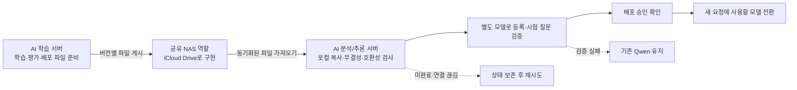

# iCloud 경유 모델 전달과 배포 방침

결정일: 2026-10-19
구현 확인: 2026-10-21

## 채택한 구조

학습 사례 전달뿐 아니라 평가된 모델 배포도 공유 NAS 역할의 iCloud Drive를 거친다.
SSH 직접 연결이나 배포 시점의 두 서버 간 HTTP 연결을 필수 조건으로 두지 않는다.
AI 분석/추론 서버가 공유 폴더를 확인하고 배포 파일을 가져오는 방식으로 설계한다.
현재 `model_delivery.py`로 시험용 MLX 어댑터의 패키지 준비·게시·수동 검증을 실행할 수 있다.
분석 서버의 자동 가져오기, Ollama 등록과 운영 모델 전환은 아직 구현하지 않았다.



공유 폴더는 파일 전달 공간이지 운영 모델을 직접 실행하는 경로가 아니다.
모델은 동기화 완료와 무결성을 확인한 후 추론 서버의 별도 로컬 저장소에 복사해 등록한다.
이미 실행 중인 분석은 기존 모델을 유지하고, 새 모델 전환은 새 요청부터 적용하도록 설계한다.

## 현재 시험 패키지

`model_delivery.py`는 학습·재로딩·원본 보존 검사를 통과한 시험 어댑터를 별도 버전으로 묶는다.
이 패키지는 실행 확인 자료이며 답변 품질 평가와 운영 배포 승인을 받은 모델이 아니다.
MLX 어댑터의 Ollama 호환성도 검증하지 않았으므로 운영 모델로 바로 등록하지 않는다.

공유 폴더에 게시하는 파일은 다음 다섯 개로 고정한다.

| 파일 | 내용 |
|---|---|
| `adapters.safetensors` | 새로 학습한 어댑터 가중치 |
| `adapter_config.json` | 허용한 LoRA 설정과 시험 목적 |
| `evaluation-summary.json` | 허용한 실행 숫자·검증 손실·재로딩 결과와 미평가 표시 |
| `manifest.json` | 버전, 기반 모델 ID·revision, 전달 파일의 크기·SHA-256, 운영 미승인 표시 |
| `READY.json` | 명세 해시와 HMAC-SHA256 서명 |

원본 승인 사례, 학습·평가 대화, 전체 실행 보고서, 로컬 경로와 비밀키는 패키지에 넣지 않는다.
`qualityEvaluation=NOT_EVALUATED`, `productionApproved=false`, `ollamaCompatible=false`를 명세에 기록한다.
서명은 `doenaai-model-delivery-v1` 전용 구분값을 사용해 다른 전송 서명과 구분한다.
검증 시 완료 표시의 서명과 명세 해시, 명세에 있는 모든 전달 파일의 크기·해시를 대조한다.

## 준비·게시·검증 명령

저장소 루트에서 실행한다. 기존 `training/.env`의 `DOENAAI_TRAINING_SHARED_DIR`와
`DOENAAI_TRAINING_TRANSFER_KEY`를 재사용하며, 키는 두 맥에서 같은 32자 이상 값이어야 한다.
이미 설정한 환경변수가 `.env`보다 우선한다. 키를 명령행 인자나 문서에 적지 않는다.
다른 설정 파일을 쓸 때는 전역 옵션 `--env-file`을 `stage`, `publish`, `verify` 앞에 둔다.

```bash
# 기존 어댑터와 보고서를 바꾸지 않고 새 로컬 패키지를 만듭니다.
training/.venv/bin/python training/model_delivery.py --env-file training/.env stage \
  --adapter training/adapters/trial-20261021-7srnohr-v3 \
  --reports training/outputs/trial-20261021-7srnohr-v3/dataset \
  --output training/outputs/model-packages/qwen-trial-20261021-v3 \
  --version qwen-trial-20261021-v3

# 같은 키로 로컬 패키지의 서명과 모든 전달 파일을 확인합니다.
training/.venv/bin/python training/model_delivery.py --env-file training/.env verify \
  --package training/outputs/model-packages/qwen-trial-20261021-v3

# 설정한 iCloud 공유 폴더에 해당 버전을 게시합니다.
training/.venv/bin/python training/model_delivery.py --env-file training/.env publish \
  --package training/outputs/model-packages/qwen-trial-20261021-v3
```

`stage`는 새 출력 경로만 허용하며 기존 패키지를 덮어쓰지 않는다.
`publish`는 공유 폴더의 `model-deliveries/qwen-trial-20261021-v3/`에 고정된 다섯 파일을 게시한다.
같은 버전이 이미 있으면 모든 파일을 검증하고 명세 해시까지 같을 때만 `ALREADY_PUBLISHED`로 처리한다.
같은 버전에 다른 내용이 있거나 기존 파일 검증에 실패하면 덮어쓰지 않고 원본을 보존한다.

게시 결과는 로컬 패키지의 `.publish-state.json`에 저장하며 공유 폴더에는 이 상태 파일을 보내지 않는다.
로컬 게시가 끝나도 `deliveryState=WAITING_FOR_REMOTE_VERIFICATION`, `cloudUploadVerified=false`다.
이는 iCloud 업로드 완료나 스튜디오 도착 확인을 뜻하지 않는다.

스튜디오에는 같은 코드와 전송 키를 준비한 뒤, 해당 장비에서 동기화된 패키지 경로를 지정해
`verify`를 실행한다. 아래 공유 폴더 경로는 스튜디오의 실제 절대 경로로 바꾼다.

```bash
python3 training/model_delivery.py --env-file training/.env verify \
  --package "/스튜디오의_iCloud_공유_폴더/model-deliveries/qwen-trial-20261021-v3"
```

정상 결과 `VERIFIED_TRIAL_ONLY`는 해당 장비에서 서명·파일 검사가 끝났다는 의미다.
파일이 아직 내려오지 않았거나 손상됐으면 동기화 상태를 확인한 뒤 같은 검증을 다시 실행한다.
수동 검증 결과를 학습 서버로 자동 회신하거나 게시 상태를 자동 완료로 바꾸는 기능은 아직 없다.

## 운영 배포 파일과 검증 기준

- 버전마다 별도 경로를 사용하고 이미 게시된 버전의 파일을 덮어쓰지 않는다.
- 배포 정보에는 배포 식별자, 기반 모델의 정확한 식별자, 파일 형식, 파일별 크기·SHA-256,
  생성 시각, 평가 결과와 배포 승인 정보를 포함한다.
- MLX 학습 어댑터가 Ollama에 바로 적용된다고 가정하지 않는다. 선택한 Qwen 모델과
  실행 환경에 맞는 병합·변환·양자화와 호환성 검증을 거쳐 배포 파일을 준비한다.
- 게시 측은 임시 파일을 사용하고 파일 준비 후 배포 정보와 완료 표시를 게시한다.
  iCloud 동기화 순서는 보장하지 않으므로 수신 측은 완료 표시만으로 배포하지 않는다.
- 수신 측은 모든 파일의 로컬 다운로드 여부, 크기와 해시를 확인한다. 누락되거나 아직
  동기화 중이면 대기하며, 반복해서 검증에 실패하는 파일은 자동 적용하지 않는다.
- 해시는 파일 손상 확인용이며 게시자 인증을 대신하지 않는다. 공유 폴더 접근 권한을
  제한하고, 배포 승인은 파일에 적힌 표시만 신뢰하지 않고 신뢰할 수 있는 승인 기록과 확인한다.
- 공유 폴더에 있는 명령이나 스크립트를 그대로 실행하지 않는다. 등록 명령·허용 경로·형식은
  수신 프로그램에서 제한하고 외부 주소나 경로 이탈이 포함된 파일 정보는 거부한다.

## 중단·중복·실패 처리

- 배포 상태는 로컬에 영속 저장한다. 서버 재시작 후에도 미완료 작업을 다시 확인한다.
- 같은 배포 식별자와 파일 해시는 중복 설치하지 않는다. 같은 식별자로 다른 파일이 오면 거부한다.
- 네트워크나 동기화가 끊기면 기존 모델로 서비스를 유지하고 미완료 배포만 재시도한다.
- 새 모델은 기존 운영 모델을 덮지 않는 별도 이름으로 등록한다. 모델 로딩, JSON 형식,
  한국어 응답과 고정 평가 질문을 검사한 뒤 승인된 버전만 활성화한다.
- 이전 모델과 활성 버전 기록을 보존해 전환 실패 시 이전 버전으로 되돌릴 수 있게 한다.
  사용 중이거나 되돌리기에 필요한 모델 파일은 자동 삭제하지 않는다.

## 현재 구현과 다음 작업

승인 사례의 게시·수신 경로와 별도로 시험 어댑터 패키지의 `stage`·`publish`·`verify`가 구현됐다.
작은 시험 파일을 이용한 신규 테스트 22개와 기존 테스트 73개가 통과했다.
실제 어댑터의 로컬 패키지 준비·검증도 완료했다. iCloud 공유 폴더의 실제 전송은 자동 승인 검토에서
사용자의 명시적 승인이 부족하다는 이유로 거부돼 실행하지 않았다. 실제 게시는 명시적 승인 대기 상태다.
로컬 검증 결과는 두 맥의 iCloud 동기화나 스튜디오의 원격 검증 성공을 대신하지 않는다.
게시·도착 여부는 각 장비에서 따로 확인한다.
현재 기본 Qwen 설정과 기존 어댑터는 유지한다.

1. 실제 패키지를 게시하고 스튜디오에서 같은 키로 수동 검증한다.
2. 동기화 대기·검증 결과 회신과 자동 가져오기를 연결한다.
3. 독립 자료로 답변 품질을 평가하고 Qwen의 병합·변환·Ollama 호환성을 검증한다.
4. 운영 승인·별도 모델 등록·전환·되돌리기를 검증한 뒤 자동 적용 기능을 운영한다.

장비별 iCloud Drive 경로와 비밀키는 로컬 설정으로 관리하고 Git에 넣지 않는다.
회사·고객 자료와 모델의 공유 가능 여부, 클라우드 저장 정책, 라이선스와 저장 공간도 확인한다.
